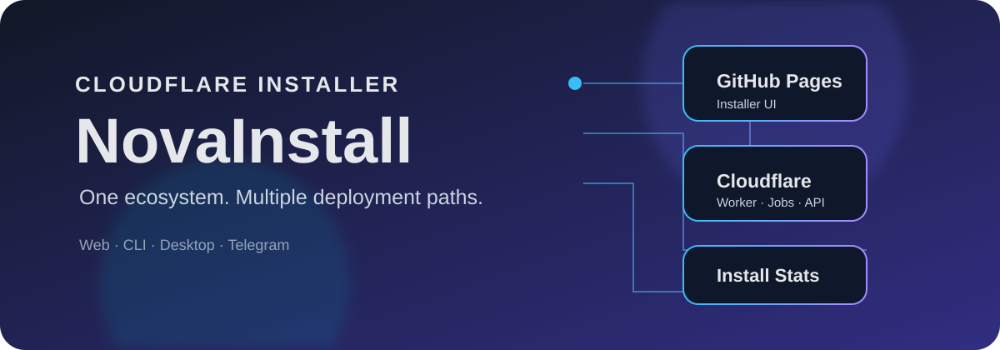
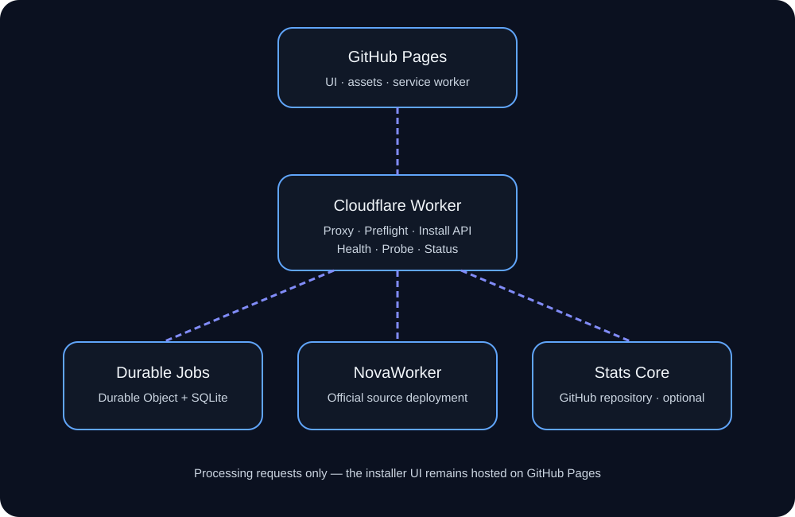
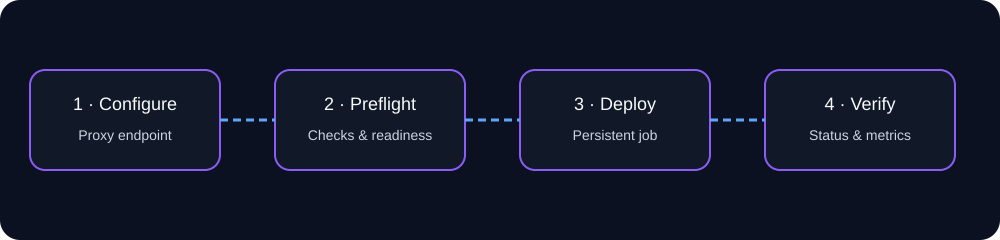

<div align="center">



# NovaInstall

### A unified deployment toolkit for **NovaWorker** on Cloudflare

**Web installer · CLI · Desktop OAuth wizard · Telegram bot**

[](https://irnova.github.io/NovaInstall/)
[](https://workers.cloudflare.com/)
[](LICENSE)

[**Launch Installer**](https://irnova.github.io/NovaInstall/) · [**Install Stats**](https://irnova.github.io/NovaInstall/stats.html) · [**Source: NovaWorker**](https://github.com/IRNova/NovaWorker)

</div>

---

## ✨ Overview

NovaInstall brings together several installation pathways for deploying the official **[IRNova/NovaWorker](https://github.com/IRNova/NovaWorker)** source to a user's Cloudflare account—without modifying the upstream repository.

The installer UI is hosted on GitHub Pages. Processing and deployment operations are handled by a dedicated Cloudflare Worker proxy. Optional install-success telemetry can be recorded within this repository's GitHub-based stats core.

> **Design principle:** the UI is hosted independently from the processing service. The page is not a redirect or loader for the Worker; it sends processing requests to the configured proxy endpoint.

## 🧭 Architecture



### Request lifecycle



1. **Configure** the proxy endpoint in `assets/proxy-endpoint.js`.
2. **Preflight** checks are performed before installation.
3. **Deploy** runs through the processing Worker, with persistent jobs in supported versions.
4. **Verify** progress and status through supported endpoints and dashboards.

## 🚀 Installation paths

| Path | Location | Description |
|---|---|---|
| 🌐 **Web Installer** | `index.html`, `assets/` | Browser-based installer hosted on GitHub Pages. |
| ⚙️ **CLI / GitHub Actions** | `scripts/install.mjs` | Deployment using Cloudflare credentials in a local environment or Actions runner. |
| 🖥️ **Desktop Wizard** | `desktop/` | Local Python OAuth-based deployment wizard. |
| 🤖 **Telegram Bot** | `bot/` | Deployment flow through a Telegram bot backed by Cloudflare Worker and D1. |

## 🌐 Web installer setup

### 1 — Deploy the processing proxy

Deploy the `proxy/` directory to Cloudflare Workers.

**Using GitHub Actions**
- Set `CF_API_TOKEN` as a repository secret.
- Optionally set `CF_ACCOUNT_ID`.
- Run the **Deploy Installer Proxy** workflow.

**Manual deployment**
```bash
cd proxy
npx wrangler@4 deploy
```

See [`proxy/README.md`](proxy/README.md) for proxy-specific instructions.

### 2 — Configure the endpoint

Edit [`assets/proxy-endpoint.js`](assets/proxy-endpoint.js) and set the Worker URL:

```js
window.NOVA_PROXY_ENDPOINT = "https://<your-proxy>.workers.dev";
```

This is the connection point between the GitHub Pages interface and the processing service.

### 3 — Enable GitHub Pages

Configure GitHub Pages for this repository so that `index.html` is served as the site entry point.

### 4 — Open the installer

**https://irnova.github.io/NovaInstall/**

## 🧱 Components

| Component | Role | Responsibilities |
|---|---|---|
| `index.html` + `assets/` | Web UI | Installer interface, client assets, endpoint configuration |
| `manifest.webmanifest` + `sw.js` | Web app support | Manifest and service-worker functionality |
| `proxy/worker.js` | Processing service | Preflight, jobs, installation, restricted Cloudflare API proxy, status |
| `scripts/install.mjs` | CLI engine | Script-based deployment |
| `.github/workflows/nova-install.yml` | Automation | CLI workflow and artifact handling |
| `desktop/` | Desktop installer | Python OAuth wizard |
| `bot/` | Telegram deployment | Telegram-based installation flow |
| `stats.json` + `stats.html` | Statistics | Repository-based installation metrics |
| `.github/workflows/record-install-stats.yml` | Stats automation | Event handling and counter updates |

## 📊 Monitoring & statistics

The optional dashboard is available at:

**https://irnova.github.io/NovaInstall/stats.html**

The proxy exposes status endpoints including:

- `/status` — status/dashboard response
- `/status.json` — structured status data
- `/health` — service health
- `/preflight` — readiness checks
- `/jobs` — installation job operations
- `/install` — install operation
- `/probe` — diagnostic probe
- `/api/*` — supported, restricted API proxy routes

> Endpoint behavior and availability depend on the deployed proxy version.

## 📈 Repository-based install statistics

Statistics can be recorded without relying on a legacy external statistics service.

- Records are stored in `stats.json`.
- The `record-install-stats.yml` workflow handles `repository_dispatch` events with the `nova_install_success` event type.
- Events are serialized and deduplicated using `event_id`.
- Sending statistics is **optional** and requires configuration.

### Optional telemetry configuration

| Variable / Secret | Purpose |
|---|---|
| `NOVA_GITHUB_STATS_TOKEN` | Fine-grained PAT with **Contents: Read and write** permission on the stats repository |
| `NOVA_GITHUB_STATS_REPO` | Optional `owner/repo` target; defaults to `IRNova/NovaInstall` |

**Telemetry privacy:** according to this project's documented design, install statistics do not store Cloudflare tokens, passwords, dashboard URLs, or Cloudflare account identifiers.

## 🔐 Security & transparency

- Keep Cloudflare credentials in GitHub Actions secrets or appropriate local secure storage.
- Never commit tokens or secrets to source files.
- Telemetry is optional.
- The installer targets the official NovaWorker repository; NovaInstall is intended to orchestrate deployment, not alter the upstream project.
- Validation and reproducibility notes are documented in [`VERIFY.md`](VERIFY.md).

## 🧪 Validation

The **Validate Installer Proxy and UI** workflow checks installer UI/proxy structure and syntax.

- Workflow: `.github/workflows/validate-proxy.yml`
- Validator: `scripts/validate-installer-ui.mjs`
- Transparency notes: [`VERIFY.md`](VERIFY.md)

## 🗂️ Repository layout

```text
NovaInstall/
├── index.html
├── assets/
├── manifest.webmanifest
├── sw.js
├── stats.html
├── stats.json
├── STATS-CORE.md
├── VERIFY.md
├── proxy/
├── scripts/
├── desktop/
├── bot/
└── .github/workflows/
```

## 🛠️ Stats core configuration

More details: [`STATS-CORE.md`](STATS-CORE.md)

The stats core uses the GitHub repository and workflow to record optional successful installation events. Configure the token and target repository only if you want installers to send events.

## 🤝 Contributing & troubleshooting

- Review the proxy setup notes in [`proxy/README.md`](proxy/README.md).
- Review bot instructions in [`bot/README.md`](bot/README.md).
- Check validation and reproducibility documentation in [`VERIFY.md`](VERIFY.md).
- Inspect the deployed Worker status endpoint and workflow logs when diagnosing issues.

## 📜 License

**MIT**, unless a separate license is specified for an individual file or directory.

---

<div align="center">

**NovaInstall** · Deployment orchestration for NovaWorker

<sub>Built around the official source · Optional statistics · Multiple deployment routes</sub>

</div>
